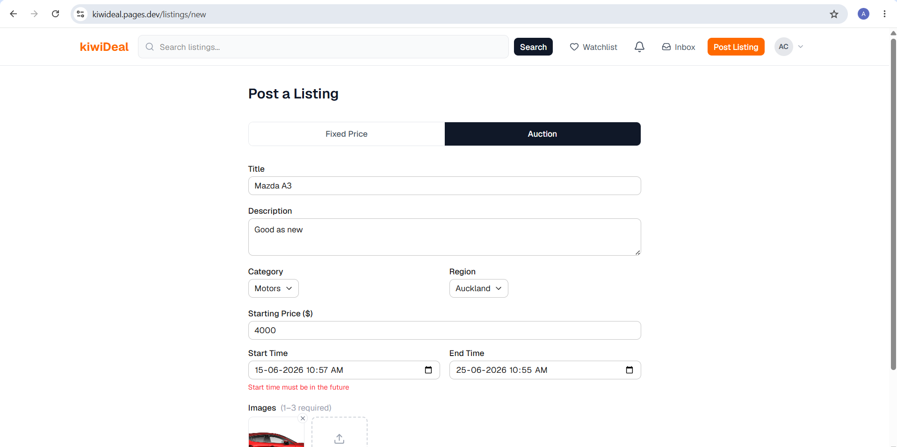
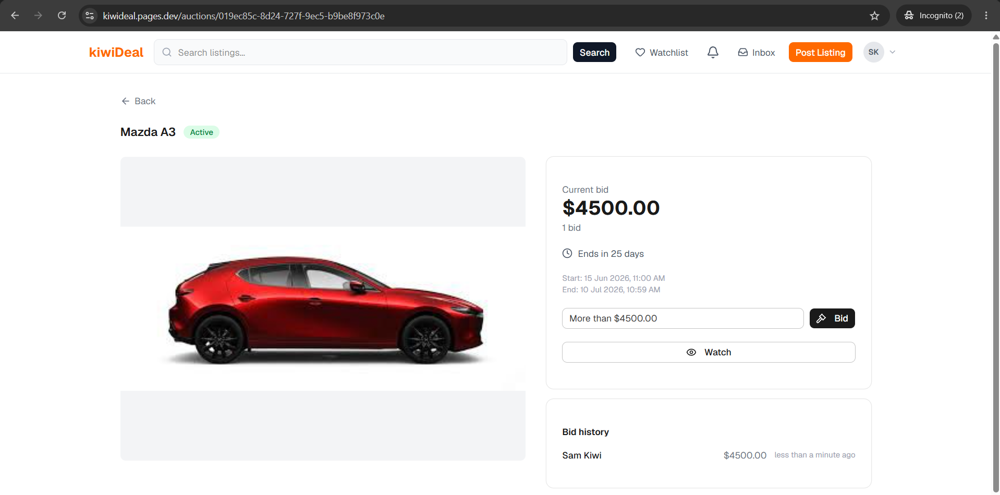
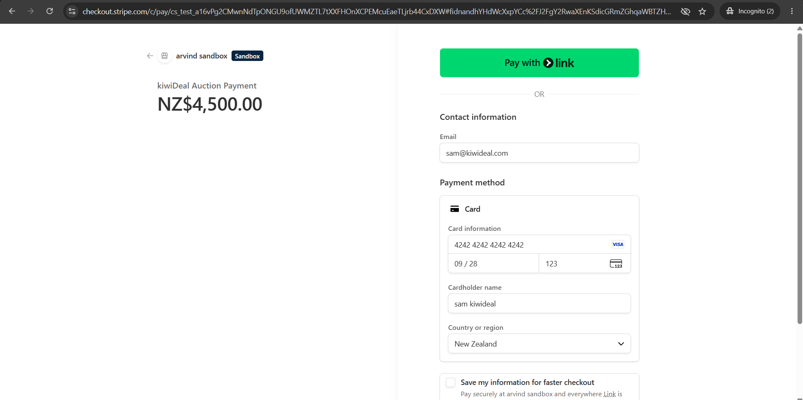
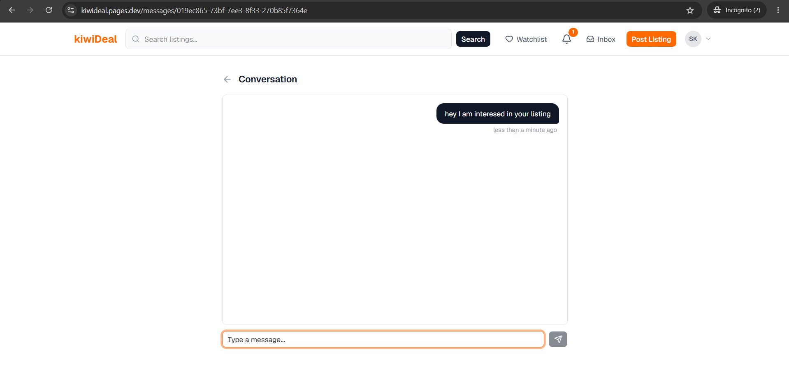
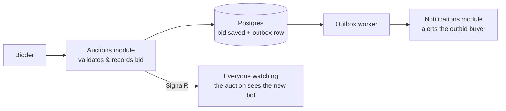
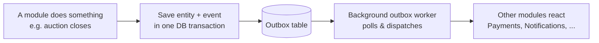
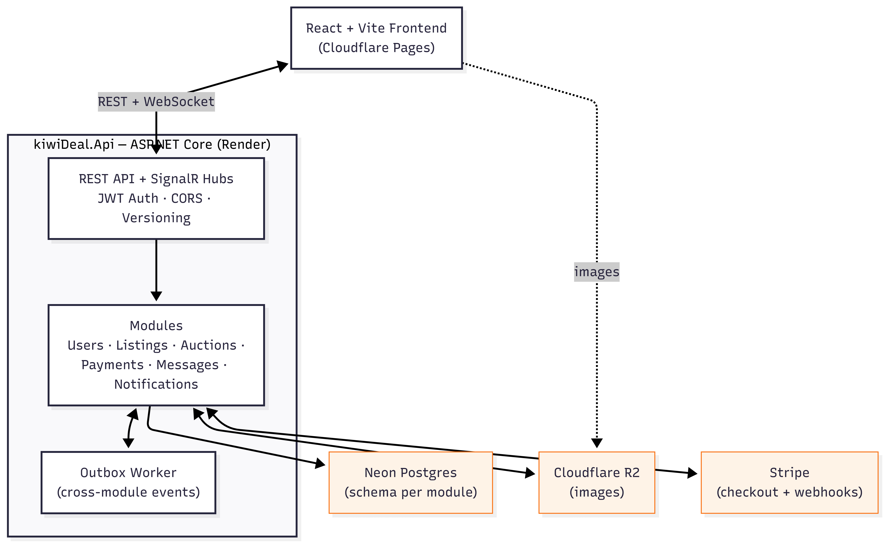

# kiwiDeal

**Buy it now, or bid to win.** A full-stack marketplace where Kiwis list, auction, and sell goods — with live bidding, real-time chat, and secure checkout.

🔗 **[Try the live demo →](https://kiwideal.pages.dev)** · [API docs](https://kiwideal-pqxq.onrender.com/scalar)

> **Heads-up:** the backend runs on a free cloud tier that sleeps when idle, so the **first request after a quiet spell can take ~10 seconds** to wake up. Everything is fast once it's warm.

---

## What is this? (the plain-English version)

kiwiDeal is an online marketplace — think of a local TradeMe or eBay. You can:

1. **List** something for sale — either at a **fixed price** or as a **timed auction**.
2. **Browse & bid** — search by category and region, watch items you like, and place bids that update live for everyone on the page.
3. **Message & pay** — chat directly with the seller, then check out securely with a card.

Every important thing that happens — a new bid, a reply, a completed payment — shows up **instantly**, with no page refresh. Under the hood that live experience is powered by real-time web sockets, and the whole app is built to demonstrate how a clean, modular backend keeps a system like this maintainable as it grows.

### Try it in 60 seconds

1. Open the [live demo](https://kiwideal.pages.dev) and register (any email + password — it's a demo, no verification).
2. Post a **listing** (fixed-price or auction) with a photo.
3. Open it in a second browser tab, **place a bid**, and watch the price update live in the first tab.
4. **Message** the seller or run a test **checkout** to see the order flow end to end.

---

## Features

- 🏷️ **Listings** — fixed-price _or_ auction-style, up to 3 images each, searchable by category and region.
- 🔨 **Live auctions** — real-time bidding over SignalR, with background workers that auto-activate and auto-close auctions on schedule.
- 👀 **Watchlist** — keep an eye on items and jump back to them from one place.
- 💬 **Direct messaging** — buyer↔seller chat with a live-updating inbox and unread counts.
- 🔔 **Real-time notifications** — instant in-app alerts for new bids, messages, and payment updates.
- 💳 **Secure payments** — Stripe Checkout with webhook-driven order status, so payment state is never guessed.
- ⭐ **Trust & reputation** — JWT auth plus post-sale ratings and reviews on user profiles.

---

## Screenshots

| Listings                                             | Live bidding                                              |
| ---------------------------------------------------- | --------------------------------------------------------- |
|  |  |
| _Post an item as fixed-price or auction_             | _Bids stream in live as they're placed_                   |

| Checkout                                  | Live messages & notifications                                                      |
| ----------------------------------------- | ---------------------------------------------------------------------------------- |
|  |  |
| _Stripe-powered secure checkout_          | _Messages and alerts arrive in real time_                                          |

---

## How it works

kiwiDeal is a **modular monolith**: one deployable API made of six self-contained modules — **Users, Listings, Auctions, Payments, Messages, Notifications** — that never call each other directly. Instead they talk through a shared **transactional outbox**, so each module stays independent without the operational cost of microservices.

**Placing a bid (real-time):**



**Cross-module events (the outbox):**



Because the domain change and its event are written in the **same transaction**, an event can never be lost or fire for a change that rolled back — the classic guarantee the outbox pattern buys you.

---

## Architecture

Each module is structured in clean layers — `Domain` (entities, rules), `Application` (CQRS handlers via MediatR), `Infrastructure` (EF Core, external services), and `Api` (controllers, hubs) — and owns its **own Postgres schema**. A small `SharedKernel` holds only the cross-cutting contracts: event definitions, the outbox, `Result` types, and MediatR pipeline behaviours (auth, validation, logging).



---

## Tech stack

| Area          | Technology                                                                                  |
| ------------- | ------------------------------------------------------------------------------------------- |
| **Backend**   | .NET 10, ASP.NET Core Web API, modular monolith, CQRS (MediatR), FluentValidation           |
| **Data**      | EF Core (Npgsql), PostgreSQL with a schema per module, transactional outbox                 |
| **Real-time** | SignalR hubs for auctions, listings, messages, and notifications                            |
| **Auth**      | JWT access/refresh tokens, per-module authorization behaviour                               |
| **API**       | Versioned endpoints with interactive Scalar docs                                            |
| **Frontend**  | React 19, TypeScript, Vite, TanStack Query, Tailwind CSS v4, shadcn/ui, React Router        |
| **Payments**  | Stripe Checkout + webhooks                                                                  |
| **Cloud**     | Render (API), Cloudflare Pages (frontend), Neon serverless Postgres, Cloudflare R2 (images) |
| **Testing**   | xUnit unit tests + Testcontainers-backed integration tests                                  |

---

## Engineering highlights

A few things worth calling out for a technical review:

- **Modular monolith with real boundaries** — six modules, each with its own layers _and its own database schema_, so nothing couples through a shared table.
- **Transactional outbox** — domain changes and their events commit together; a background worker (with retry tracking) dispatches them, giving reliable, at-least-once cross-module messaging.
- **Real-time by default** — dedicated SignalR hubs push bids, messages, and notifications the instant they happen, no polling.
- **Scheduled auction lifecycle** — background workers activate and close auctions on time, and optimistic concurrency (row versioning) keeps simultaneous bids correct.
- **Webhook-driven payments** — order status is updated from Stripe webhooks (`checkout.session.completed` / `expired`), never inferred from the redirect.
- **Consistent request pipeline** — MediatR behaviours apply authentication, validation, and logging uniformly, and a `Result` type carries typed errors instead of exceptions for control flow.

---

## Getting started (local development)

**Prerequisites:** [.NET 10 SDK](https://dotnet.microsoft.com/download), [Node.js 20+](https://nodejs.org/), and [Docker](https://www.docker.com/) (for local Postgres).

```bash
# 1. Start Postgres (localhost:5432) with per-module schemas pre-created
docker-compose up -d

# 2. Configure secrets via .NET user-secrets (never commit real values).
#    Set one connection string per module, plus JWT / Stripe / R2 keys.
dotnet user-secrets set "ConnectionStrings:UsersConnection" \
  "Host=localhost;Port=5432;Database=kiwidealddb;Username=kiwiadmin;Password=kiwipassword;Search Path=users" \
  --project src/kiwiDeal.Api
#    ...repeat for Listings, Auctions, Payments, Messages, Notifications

# 3. Apply migrations (one context per module)
dotnet ef database update \
  --project src/Modules/Users/kiwiDeal.Users.Infrastructure \
  --startup-project src/kiwiDeal.Api --context UsersDbContext
#    ...repeat for the other five modules

# 4. Run the API — available at http://localhost:5158, docs at /scalar
dotnet run --project src/kiwiDeal.Api
```

```bash
# 5. Run the frontend — available at http://localhost:5173
cd frontend
npm install
npm run dev   # set VITE_API_URL=http://localhost:5158/api/v1 in frontend/.env.local
```

---

## Environment variables

| Variable                                                                 | Description                                                                                                 |
| ------------------------------------------------------------------------ | ----------------------------------------------------------------------------------------------------------- |
| `ConnectionStrings__{Module}Connection`                                  | Postgres connection string per module schema (Users, Listings, Auctions, Payments, Messages, Notifications) |
| `JwtSettings__Secret` / `Issuer` / `Audience` / `ExpiryMinutes`          | JWT signing config                                                                                          |
| `Stripe__SecretKey` / `WebhookSecret` / `SuccessUrl` / `CancelUrl`       | Stripe API key, webhook signing secret, redirect URLs                                                       |
| `R2__AccountId` / `AccessKey` / `SecretKey` / `BucketName` / `PublicUrl` | Cloudflare R2 credentials for image storage                                                                 |
| `AllowedOrigins`                                                         | CORS allowed origin (frontend URL)                                                                          |
| `VITE_API_URL` _(frontend)_                                              | Base URL of the backend API                                                                                 |

---

## Testing

```bash
# Unit tests
dotnet test tests/kiwiDeal.Tests.Unit

# Integration tests — spins up a real Postgres via Testcontainers (Docker required)
dotnet test tests/kiwiDeal.Tests.Integration
```

---

## Deployment

- **Backend** — [Render](https://render.com) Docker web service, built from the root `Dockerfile`.
- **Frontend** — [Cloudflare Pages](https://pages.cloudflare.com), built from `frontend/` (`npm run build` → `dist`).
- **Database** — [Neon](https://neon.tech) serverless Postgres, one database with a schema per module.
- **Images** — [Cloudflare R2](https://developers.cloudflare.com/r2/), public bucket for listing photos.
- **Payments** — [Stripe](https://stripe.com), webhook at `/api/v1/payments/webhook` for `checkout.session.completed` / `expired`.

---

## Project structure

```
src/
├── Modules/
│   ├── Users/           # Auth, profiles, ratings & reviews
│   ├── Listings/        # Fixed-price & auction listings, images, search
│   ├── Auctions/        # Bidding, watchlist, activation/closing workers
│   ├── Payments/        # Stripe Checkout + webhooks
│   ├── Messages/        # Buyer↔seller chat
│   └── Notifications/   # Real-time in-app alerts
│       └── each module → Domain · Application · Infrastructure · Api
├── SharedKernel/        # Event contracts, outbox, Result types, MediatR behaviours
└── kiwiDeal.Api/        # Host: DI, SignalR hubs, versioned API, Scalar docs
frontend/                # React + TypeScript app
tests/                   # Unit and Testcontainers-backed integration suites
scripts/                 # init-schemas.sql (per-module Postgres schemas)
```

---

_Built as a portfolio project to demonstrate a real-time, event-driven modular monolith in .NET — clean module boundaries, a transactional outbox, and live SignalR experiences on cloud-native infrastructure._
