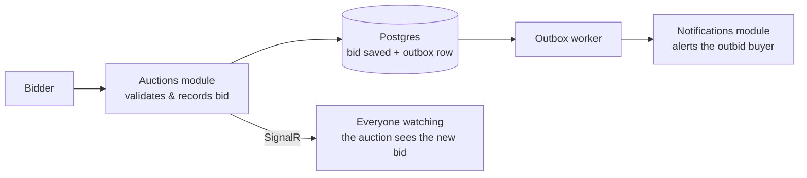
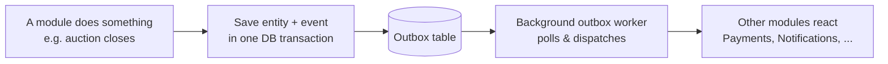

# kiwiDeal

kiwiDeal is a full-stack online marketplace where users can list, auction, and sell goods. It features real-time live bidding, direct user-to-user chat, and secure checkout processing.

**Links:**

* **Live Demo:** [kiwideal-aml.pages.dev/listings](https://kiwideal-aml.pages.dev/listings)
* **API Documentation:** [Render Scalar Docs](https://kiwideal-x70k.onrender.com/scalar)

*Note: The backend is hosted on a free cloud tier that sleeps when idle; the initial request may take approximately 10 seconds to process.*

---

| | |
|:---:|:---:|
|  |  |
| *Post an item as fixed-price or auction* | *Bids stream in live as they're placed* |
|  |  |
| *Stripe-powered secure checkout* | *Messages and alerts arrive in real time* |

---

## Core Features

* **Marketplace Listings:** Support for both fixed-price and timed auction listings, complete with image uploads and category/region filtering.


* **Live Auctions:** Real-time bidding powered by SignalR web sockets, complemented by background workers that automatically activate and close auctions on schedule.


* **Direct Messaging:** A buyer-to-seller chat system featuring a live-updating inbox and unread message counts.


* **Real-Time Notifications:** Instant, zero-refresh alerts for new bids, messages, and payment status updates.


* **Secure Checkout:** Integrated Stripe payments utilizing webhook-driven order statuses to ensure accurate transaction states.


## Architecture

**Placing a bid (real-time):**



**Cross-module events (the outbox):**



## Technology Stack

* **Backend:** .NET 10, ASP.NET Core Web API, Modular Monolith Architecture


* **Frontend:** React 19, TypeScript, Vite, TanStack Query, Tailwind CSS v4, shadcn/ui


* **Database & ORM:** PostgreSQL, Entity Framework Core (Npgsql)


* **Real-time & Payments:** SignalR, Stripe Checkout & Webhooks


* **Infrastructure:** Render (API), Cloudflare Pages (Frontend), Neon (Database), Supabase (Image Storage)


## Engineering Highlights

* **Modular Monolith:** The backend is divided into six independent modules (Users, Listings, Auctions, Payments, Messages, Notifications), each operating with its own isolated database schema to prevent tight coupling.


* **Transactional Outbox Pattern:** Cross-module messaging is handled reliably by saving domain changes and events in a single database transaction, processed by a background worker.


* **CQRS Implementation:** MediatR is utilized to segregate commands and queries, with a unified pipeline applying authentication, validation, and logging rules.


* **True Integration Testing:** The test suite utilizes Testcontainers to spin up real PostgreSQL instances for integration testing, avoiding mocked database constraints.


## Local Development

Prerequisites for local deployment include Docker, the .NET 10 SDK, and Node 20+.

```bash
# 1. Start Postgres (localhost:5432) with per-module schemas pre-created
docker-compose up -d

# 2. Configure env vars for backend
cd src/kiwiDeal.Api
cp .env.example .env

# 3. Apply migrations (one context per module)
dotnet ef database update --project ../Modules/Users/kiwiDeal.Users.Infrastructure --startup-project . --context UsersDbContext
# ...repeat for Listings, Auctions, Payments, Messages, Notifications

# 4. Run the API
dotnet run 

# 5. Run the frontend
cd ../../frontend
cp .env.example .env
npm install
npm run dev

```

## Project Structure Overview

* `src/Modules/`: Contains the six independent modules (Users, Listings, Auctions, Payments, Messages, Notifications), each layered by Domain, Application, Infrastructure, and API.


* `src/SharedKernel/`: Core shared definitions including event contracts, outbox logic, Result types, and MediatR pipeline behaviors.


* `src/kiwiDeal.Api/`: The primary host application containing Dependency Injection, SignalR Hubs, and versioned controllers.


* `frontend/`: React client application directory.


## Contact

Arvind Chauhan

* **LinkedIn:** [linkedin.com/in/arvind-chauhan-dev](https://www.linkedin.com/in/arvind-chauhan-dev/)
* **Email:** [arvind05094@gmail.com](mailto:arvind05094@gmail.com)